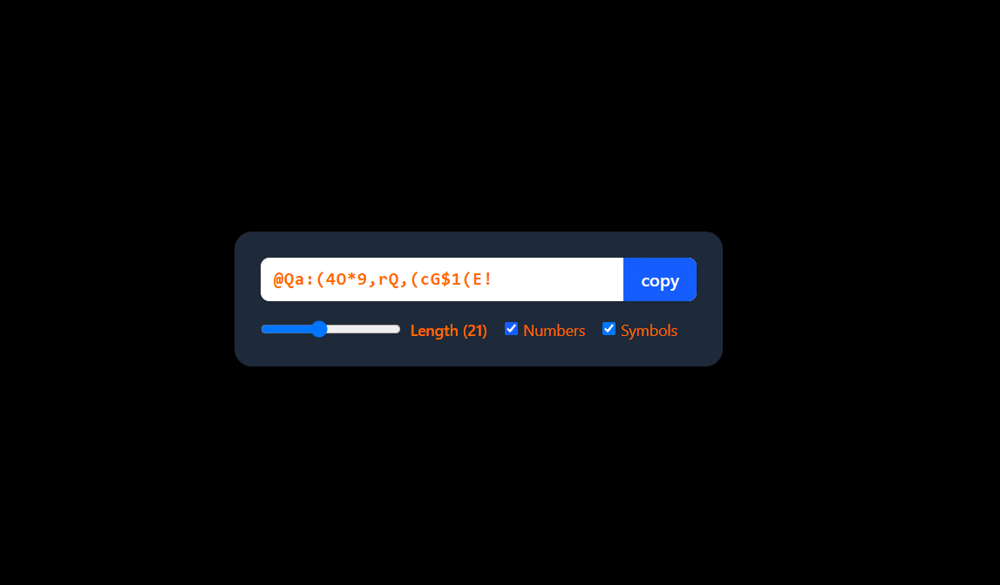

# Password Generator

A simple and interactive password generator built with React and Tailwind CSS.

The application allows users to generate passwords by choosing their preferred length and deciding whether numbers and symbols should be included.

Password generation updates automatically whenever the selected options change, with a one-click option to copy the generated password.

## Table of Contents

- [Overview](#overview)
- [Features](#features)
- [How It Works](#how-it-works)
- [React Concepts Used](#react-concepts-used)
- [Project Structure](#project-structure)
- [Tech Stack](#tech-stack)
- [Getting Started](#getting-started)
- [Available Scripts](#available-scripts)

## Overview

This project demonstrates how React Hooks can be used to build an interactive utility with configurable inputs and automatically updated output.

Users can control password length, enable numbers, and include symbols. The generated password is displayed in a read-only input field and can be copied to the clipboard.

## Preview



## Features

- **Automatic Password Generation** — Generates a password when the application loads or generation settings change.
- **Adjustable Password Length** — Choose a password length between 8 and 40 characters.
- **Numbers Option** — Include numeric characters in the generated password.
- **Symbols Option** — Include special characters in the generated password.
- **Live Configuration** — Updates the generated password when the selected options change.
- **Copy to Clipboard** — Copies the generated password with a single click.
- **Responsive Layout** — Uses Tailwind CSS utility classes for layout and styling.

## How It Works

### 1. Password Configuration

The application maintains three configuration values:

- `length` — Controls the number of characters.
- `numberAllowed` — Determines whether numeric characters are included.
- `symbolAllowed` — Determines whether special characters are included.

### 2. Character Selection

The generator starts with uppercase and lowercase English letters.

Depending on the selected options, it adds:

- Numeric characters (`0–9`)
- Special characters

### 3. Password Generation

The `passwordGenerator` function builds a password using the selected character set and configured length.

The generated result is stored in React state and displayed in the input field.

### 4. Automatic Updates

A `useEffect` watches the generation settings and calls the password generator when those settings change.

### 5. Copy to Clipboard

The application uses `useRef` to reference the password input and the browser Clipboard API to copy the generated value.

## React Concepts Used

| Hook / Concept | Purpose                                                                          |
| -------------- | -------------------------------------------------------------------------------- |
| `useState`     | Manages password, length, numbers, and symbols settings.                         |
| `useCallback`  | Memoizes the password generation and copy functions based on their dependencies. |
| `useEffect`    | Triggers password generation when configuration changes.                         |
| `useRef`       | References the password input for selection and clipboard interaction.           |
| Event Handling | Handles slider changes, checkbox interactions, and copy button clicks.           |

## Project Structure

```text
password-generator/
├── src/
│   ├── App.jsx
│   ├── index.css
│   └── main.jsx
├── index.html
├── package.json
├── package-lock.json
└── vite.config.js
```

## Tech Stack

| Technology              | Purpose                                          |
| ----------------------- | ------------------------------------------------ |
| React 19                | Component-based UI and state management.         |
| JavaScript (ES Modules) | Password generation and application logic.       |
| Tailwind CSS 4          | Utility-first styling and responsive layout.     |
| Vite 8                  | Development server and production build tooling. |
| Oxlint                  | JavaScript and JSX linting.                      |
| Browser Clipboard API   | Copying generated passwords.                     |

## Getting Started

### Prerequisites

- Node.js
- npm

### Installation

1. Clone the repository:

```bash
git clone https://github.com/hadiashah01/password-generator.git
```

2. Navigate into the project:

```bash
cd password-generator
```

3. Install dependencies:

```bash
npm install
```

4. Start the development server:

```bash
npm run dev
```

5. Open the local URL shown in your terminal.

## Available Scripts

| Command           | Description                            |
| ----------------- | -------------------------------------- |
| `npm run dev`     | Starts the Vite development server.    |
| `npm run build`   | Creates a production build.            |
| `npm run preview` | Previews the production build locally. |
| `npm run lint`    | Runs Oxlint.                           |

]

## Author

**Hadia Shahjahan**

**Repository:** [password-generator](https://github.com/hadiashah01/password-generator)  
**Github:** [Github Profile Link ](https://github.com/hadiashah01/)  
**Linkedin:** [Linkedin Profile Link ](https://www.linkedin.com/in/hadia-shahjahan/)
